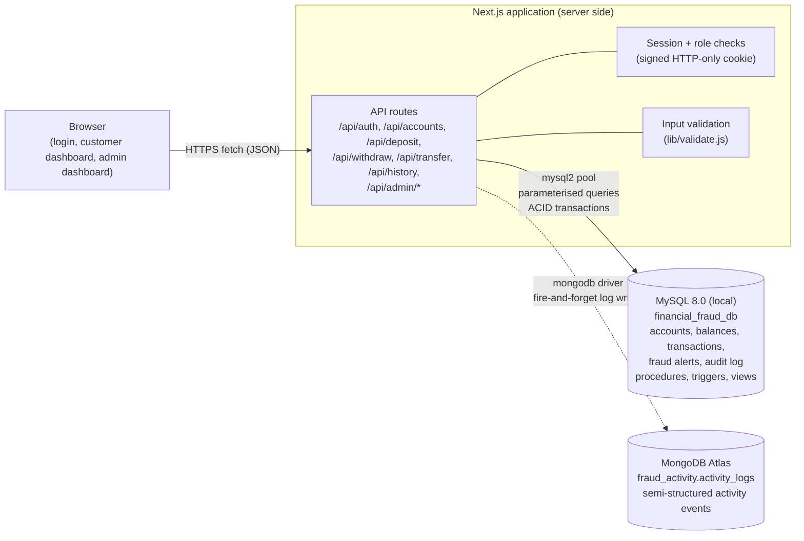
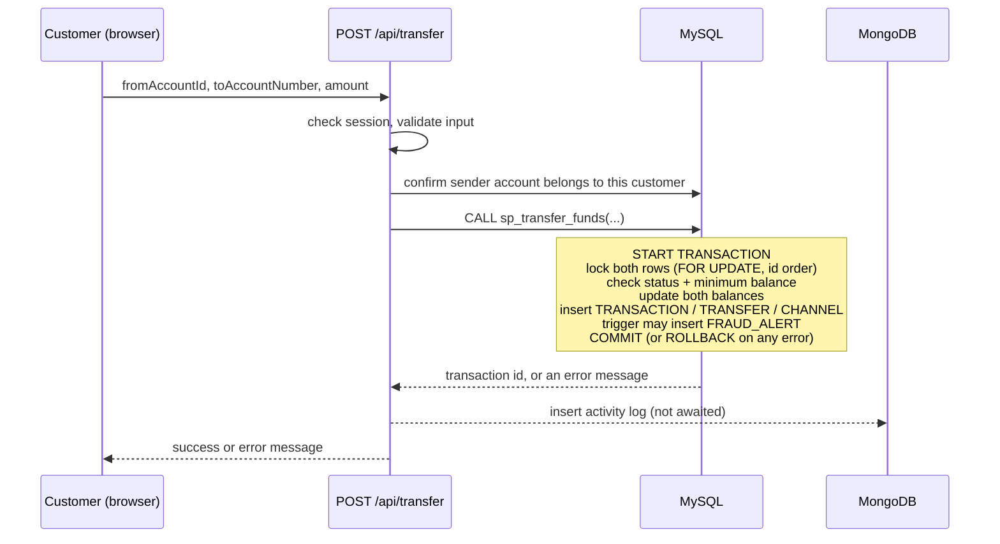

# Architecture

## System diagram

The browser never talks to a database. Only the server-side API routes hold database credentials (in `.env.local`).

## Who stores what

| Data | Database | Why |
|---|---|---|
| Customers, accounts, balances, transactions, deposits, withdrawals | MySQL | Money needs ACID transactions, foreign keys and CHECK constraints |
| Fraud rules and alerts, audit log, curated security events | MySQL | Formal records linked to transactions and customers; reviewed with joins |
| Activity log (every login, transfer, deposit, withdrawal, admin review) | MongoDB | High-volume, append-only, and each event type carries different fields; analysed with aggregation pipelines |

The account balance exists **only** in MySQL.

## Transfer flow

## Failure handling between the two databases
MySQL and MongoDB cannot share one transaction. So the money operation is committed in MySQL first, and the MongoDB log write happens afterwards without blocking or failing the request. If MongoDB is unavailable, the transfer still succeeds, the error is printed in the server console, and only that activity-log row is lost. Critical records that must not be lost (fraud alerts, audit log, security events) are written to MySQL.

## Security measures
* bcrypt password hashing; plaintext passwords are never stored.
* Signed (HMAC-SHA256), HTTP-only session cookie that expires after 2 hours; the role is read from the signed cookie, so the browser cannot change it.
* Role checks on the server for every API route (`CUSTOMER` routes and `ADMIN` routes).
* Ownership checks: a customer can only use their own accounts.
* Parameterised queries everywhere (prevents SQL injection); inputs validated before use.
* The web app connects with a limited MySQL user (`fraud_app`: SELECT, INSERT, UPDATE, DELETE, EXECUTE only), never root.
* Credentials and the session secret live in `.env.local`, which is git-ignored.
* Same error message for wrong username and wrong password; failed logins are logged.

## Technology
Next.js (App Router) + React + Tailwind CSS, Node.js, `mysql2`, `bcryptjs`, `mongodb` driver, MySQL 8.0.33, MongoDB Atlas.
